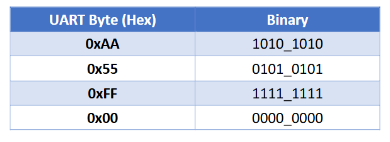
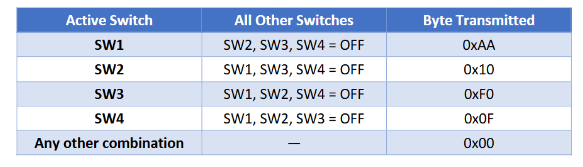
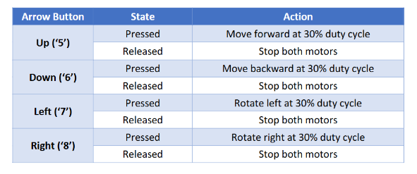

# ECE 528/L - Robotics and Embedded Systems with Lab
**CSU Northridge**

**Department of Electrical and Computer Engineering**

## Bluetooth Low Energy (BLE) Lab

### Overview:

### Components Used:
The Bluetooth Low Energy (BLE) lab interfaces with the following:
* User LEDs of the TI MSP432 LaunchPad
* Pololu Gearmotor with Encoder - [Product Link](https://www.pololu.com/product/3675)
* Adafruit Bluefruit LE UART Friend - Bluetooth Low Energy (BLE) Module - [Product Link](https://www.adafruit.com/product/2479)


### Analysis and Results: 

#### Pre-Lab 
---
***Prelab Questions***

**1. What is Bluetooth Low Energy (BLE)? How does it differ from regular Bluetooth in terms of power consumption and range?**

BLE is an extension of regular Bluetooth built with the main focus on IoT devices. It adds on new physical layers and a "new advertising mechanism, for ease of discovery and connection". This translated to BLE having a power consumption of around 0.01 W–0.50 W, and a range of between 50 m–100 m. Compare that to regular Bluetooth that consumes more closely around 1 W and a range of 100 m.


**2. What does GAP stand for and what is its purpose? What is the difference between Peripheral and Central devices in the context of BLE?**

GAP stands for Generic Access Profile, which is used to discover and connect devices, broadcast data, and establish connections. In terms of BLE, items labeled as "Peripherals" take a "Slave Role", that advertise as a possible connection point but don't initiate the connection, and are optimized to consume the least amount of power and memory when in use. Devices labeled as "Central" take a "Master Role", where they are capable of establishing as well as managing the connection. This also means that it may be connected to multiple devices.


**3. What is GATT in BLE, and how does it structure data exchange between connected devices? Provide definitions for the following: Profile, Service, and Characteristic.**


GATT stands for Generic Attribute Profile, and it is used to organize and exchange data over BLE. It uses an Attribute Protocol (ATT) to structure the data into easily transmitted bits called attributes. These attributes are structured with bits conveying handle, type, value, and permission in that order.

Profile is the overall encompassing predefined group containing services and characteristics. Services are a collection of data and associated behaviors to accomplish a particular function. Lastly, Characteristics are essentially containers for user data. They contain a minimum of two attributes: Metadata for the Value Attribute, and contains the data value itself.


**4. What is an advertising packet in BLE and what information can it contain?**

An advertising packet is a short message that is sent out repeatedly, used to let other devices read data or find the device in order to establish a connection. These packets can contain data such as flags that tell whether the device is connectable, local name of the device, service offered/service name as well as the service data, the power that was used to transmit the message, as well as device designation that tells whether the device is a smartphone or watch, etc.


**5. What is a UUID used for in BLE and why are 128-bit UUIDs used? You can use this page as a reference.**

UUID is known as Universally Unique Identifier, and is part of the "Type" section of the attribute structure. It is used to identify profiles, services, and data types in a Generic Attribute (GATT) profile. The reason 128 bits are used is so that no central registration authority needs to oversee these identifying numbers. This is accomplished since 128 bits makes it a near-zero chance that the numbers are duplicated.

**6. What bit from which register determines if the UART data is received or transmittedv MSB or LSB first? Refer to the eUSCI_A UART Registers section (24.4) of the MSP432P4xx Technical Reference Manual (SLAU356I)**

The register that determines whether the UART data is received or transmitted MSB or LSB first is the `CTLW0` register, specifically bit 13.

**7. Provide the mnemonic and primary module function for each pin listed. Refer to Table 6-45 (Default Mapping) on page 126 of the MSP432P401R Datasheet.**

|Pin|Mnemonic| Input Pin Primary Function| Output Pin Primary Function|
|----|--------|---------------------------|----------------------------|
|P2.2| PM_UCA1RXD/PM_UCA1SOMI | eUSCI_A1 UART RXD (direction controlled by eUSCI – input) | eUSCI_A1 SPI slave out master in (direction controlled by eUSCI) |
|P2.3| PM_UCA1TXD/PM_UCA1SIMO | eUSCI_A1 UART TXD (direction controlled by eUSCI – output) | eUSCI_A1 SPI slave in master out (direction controlled by eUSCI) |
|P3.2| PM_UCA2RXD/PM_UCA2SOMI | eUSCI_A2 UART RXD (direction controlled by eUSCI – input) | eUSCI_A2 SPI slave out master in (direction controlled by eUSCI) |
|P3.3| PM_UCA2TXD/PM_UCA2SIMO | eUSCI_A2 UART TXD (direction controlled by eUSCI – output) | eUSCI_A2 SPI slave in master out (direction controlled by eUSCI) |

***PreLab Coding***

**Write a void function named P2_2_and_P2_3_Init that takes no arguments and configures the following pins to use primary function mode: P2.2 and P2.3. It is not necessary to set the direction of the pins. Refer to the following documents:**

-   **Section 12.2.6 – “Function Select Registers (PxSEL0, PxSEL1)” of the MSP432P4xx Technical Reference Manual (SLAU356I)**

- **Section 4.1 – “Pin Diagrams” and Section 6.12.2 – “Port P2 (P2.0 to P2.3)Input/Output With Schmitt Trigger” of the MSP432P401R Datasheet**


```c

void P2_2_and_P2_3_Init (void){

    P2->SEL0 |= 0x0C; 
    P2->SEL1 &= ~0x0C; 

}

```

---
#### Lab Tasks

For all the lab tasks, we will be using the Bluefruit Connect application to send messages over BLE to our MSP432 robot and perform specific actions based on what was sent. But first, we need to set up the driver files and `main.c`, after which each "Tasks" subsection will explain what main goal was to be achieved.


##### ***UART Driver Setup***

The lab calls for us to set up the source file `BLE_UART.c` with the initialization functions and helper functions that take in strings and character arrays and create the output string for the data. Below is the source file that was implemented:

```c
#include "../inc/BLE_UART.h"

//=====================================================================
/* Initializes eUSCI_A3 in UART mode to talk to the Adafruit Bluefruit LE UART Friend module.
 *
 * Sets P9.6 and P9.7 to their primary UART function and P1.6 as a GPIO output for the MOD pin.
 * Configures the UART for 8 data bits, no parity, 1 stop bit, LSB first, clocked from SMCLK at 9600 baud.
 */
void BLE_UART_Init()
{

    P9->SEL0 |= 0xC0;
    P9->SEL1 &= ~0xC0;

    P1->SEL0 &= ~0x40;
    P1->SEL1 &= ~0x40;
    P1->DIR |= 0x40;


    EUSCI_A3->CTLW0 |= 0x01;
    EUSCI_A3->MCTLW &= ~0xFF;
    EUSCI_A3->CTLW0 &= ~0x8000;
    EUSCI_A3->CTLW0 &= ~0x4000;
    EUSCI_A3->CTLW0 &= ~0x2000;
    EUSCI_A3->CTLW0 &= ~0x1000;
    EUSCI_A3->CTLW0 &= ~0x0800;
    EUSCI_A3->CTLW0 &= ~0x0600;
    EUSCI_A3->CTLW0 &= ~0x0100;
    EUSCI_A3->CTLW0 |= 0x00C0;

    EUSCI_A3->BRW = 1250;
    EUSCI_A3->IE &= ~0x0C;
    EUSCI_A3->IE |= 0x03;

    EUSCI_A3->CTLW0 &= ~0x01;


}


//=====================================================================
// Waits until a byte arrives in the eUSCI_A3 receive buffer, then returns it.
// Returns the 8-bit character read from the RXBUF register.
uint8_t BLE_UART_InChar()
{

    while ((EUSCI_A3->IFG & 0x01) == 0 );
    return EUSCI_A3->RXBUF;
}


//=====================================================================
// Waits until the eUSCI_A3 transmit buffer is ready, then sends one byte to the BLE module.
// Takes in the 8-bit character to transmit.
void BLE_UART_OutChar(uint8_t data)
{

    while ((EUSCI_A3->IFG & 0x02) == 0 );
    EUSCI_A3->TXBUF = data;


}


//=====================================================================
/*
Reads characters from the BLE module into a buffer until a line feed (LF) is received.

Handles backspace (BS) by removing the last character, ignores characters once the buffer is full,
and null-terminates the string.

Takes the pointer to the character buffer that stores the received string
and the maximum number of characters the buffer can hold.

It returns the number of characters stored in the buffer.
*/

int BLE_UART_InString(char *buffer_pointer, uint16_t buffer_size)
{

    int length = 0;
    int string_size = 0;

    char character = BLE_UART_InChar();

    while(character != LF)
    {
      if (character == BS)
      {
        if(length)
        {

            buffer_pointer--;
            length--;
            BLE_UART_OutChar(BS);

        }
    }

    else if (length < buffer_size)
        {
            *buffer_pointer = character;
            buffer_pointer++;
            length++;
            string_size++;
        }
        character = BLE_UART_InChar();
    }
    *buffer_pointer = 0;
    return string_size;
}


//=====================================================================
// Sends a null-terminated string to the BLE module one character at a time.
// It takes in a pointer to the string to transmit.

void BLE_UART_OutString(char *pt)
{

    while(*pt)
    {
        BLE_UART_OutChar(*pt);
        pt++;
    }


}


//=====================================================================
/*
Checks whether a given string appears anywhere in the BLE UART data buffer.

Takes in the buffer holding the received BLE data and the string to search for.
*/

uint8_t Check_BLE_UART_Data(char BLE_UART_Data_Buffer[], char *data_string)
{
    if(strstr(BLE_UART_Data_Buffer,data_string) != NULL)
    {
        return 0x01;
    }
    else
    {
        return 0x00;
    }

}


//=====================================================================
/*
Performs a software reset of the BLE module using the "ATZ" AT command.

Drives the MOD pin (P1.6) high to enter command mode, sends "ATZ", waits for the module to reset,
then drives MOD low to return to data mode.
*/


void BLE_UART_Reset()
{

    P1->OUT |= 0x40;
    Clock_Delay1ms(1000);

    BLE_UART_OutString("ATZ\r\n");
    Clock_Delay1ms(3000);

    P1->OUT &= ~0x40;


}
```

---

##### UART Header File Setup

Additionally, we are tasked with setting up the header file `BLE_UART.h` with predefined variables/constants:

```c
#ifndef INC_BLE_UART_H_
#define INC_BLE_UART_H_

#define BLE_UART_BUFFER_SIZE 128
#define CR 0x0D
#define LF 0x0A
#define BS 0x08
#define ESC 0x1B
#define SP 0x20
#define DEL 0x7F


#include <stdint.h>
#include <string.h>
#include "msp.h"
#include "Clock.h"

void BLE_UART_Init();

uint8_t BLE_UART_InChar();

void BLE_UART_OutChar(uint8_t data);

int BLE_UART_InString(char *buffer_pointer, uint16_t buffer_size);

void BLE_UART_OutString(char *pt);

uint8_t Check_BLE_UART_Data(char BLE_UART_Data_Buffer[], char *data_string);

void BLE_UART_Reset();

#endif /* INC_BLE_UART_H_ */
```

---

##### ***Setting Up `main.c`***

With the `BLE_UART` source and header written, the `main.c` file was written so that everything is initialized and processes an input text value, using an additional `Process_BLE_UART` function.

```c
void Process_BLE_UART_Data(char BLE_UART_Buffer[])
{

    if(Check_BLE_UART_Data(BLE_UART_Buffer, "RGB LED GREEN"))
        {
            LED2_Output(RGB_LED_GREEN);

        }
    else if (Check_BLE_UART_Data(BLE_UART_Buffer,"RGB LED OFF"))
        {

            LED2_Output(RGB_LED_OFF);

        }
    else if(Check_BLE_UART_Data(BLE_UART_Buffer,"DANY"))
    {
            TX_Msg_A();
            printf("Sending TX Msg A \n");
    }

    else
        {

        printf("BLE UART Command Not Found \n");

        }

}


int main(void)
{

    DisableInterrupts();
    Clock_Init48MHz();
    LED2_Init();
    EUSCI_A0_UART_Init_Printf();
    BLE_UART_Init();
    Motor_Init();

    char BLE_UART_Buffer[BLE_UART_BUFFER_SIZE] = {0};

    EnableInterrupts();

    Clock_Delay1ms(1000);
    BLE_UART_Reset();

    BLE_UART_OutString("BLE UART Active\r \n");
    Clock_Delay1ms(1000);


    while(1)
    {

        int string_size = BLE_UART_InString(BLE_UART_Buffer, BLE_UART_BUFFER_SIZE);

        printf("BLE UART Data: ");

        for (int i = 0 ; i < string_size; i++)
        {
            printf("%c", BLE_UART_Buffer[i]);
        }

        printf("\n");

        Process_BLE_UART_Data(BLE_UART_Buffer);


    }
}
```

---

##### **Task 1**

###### ***Part A***

With the completed `main.c`, the first task was to implement two ways of transmitting 4 unique bytes. The two implementation methods are broken into two parts: Part A, "Fixed Byte Transmission," implementing 4 unique back-to-back transmissions of data following the definitions in the table below.



Our implementation sends the bytes only once, and they are only sent when a specified value is sent to the module; in this case, it's `DANY`, as shown in our implementation code below. We implemented this by creating a `TX_Msg_A` function that contains the 4 bytes we want to send, modifying `Process_BLE_UART_Data` to have an additional `else if`, and using the same `main` function that was initially set up during the prelab section of this lab. The results for this part of the lab can be seen in the Results section in the corresponding subsection.

```c
void TX_Msg_A(void)
{

    BLE_UART_OutChar(170);
    Clock_Delay1ms(10);
    BLE_UART_OutChar(85);
    Clock_Delay1ms(10);
    BLE_UART_OutChar(255);
    Clock_Delay1ms(10);
    BLE_UART_OutChar(0);
    Clock_Delay1ms(10);

}
```

```c
void Process_BLE_UART_Data(char BLE_UART_Buffer[])
{

    if(Check_BLE_UART_Data(BLE_UART_Buffer, "RGB LED GREEN"))
        {
            LED2_Output(RGB_LED_GREEN);

        }
    else if (Check_BLE_UART_Data(BLE_UART_Buffer,"RGB LED OFF"))
        {

            LED2_Output(RGB_LED_OFF);

        }
    else if(Check_BLE_UART_Data(BLE_UART_Buffer,"DANY"))
    {
            TX_Msg_A();
            printf("Sending TX Msg A \n");
    }

    else
        {

        printf("BLE UART Command Not Found \n");

        }

}
```

###### ***Part B***

Part B, "UART Transmission Using PMOD SWT," on the other hand, uses the PMOD switches to continuously send one type of message based on the switch configuration of the PMOD, which is summarized in the table below.



We implemented this using ...........

---

##### **Task 2**

The last task of this lab is to implement/modify the `BLE_UART_InString` function to be able to decode button presses from the Bluefruit Connect application and control the MSP432 robot following the functionality described in the summary table below.



We implemented a function called `Decode_Controller_Packet` that takes in the saved buffer from `BLE_UART_InString` and follows the design criteria:

- Discard incoming characters until it receives the `!` header (`0x21`).
- Store the `!` header and the next four bytes in the `BLE_UART_Buffer` array and return without waiting for a Line Feed character.

We also added `printf` to display what actions are being performed.

---

##### **Results**

###### ***Task 1 Part A***

We captured all 4 transmitted messages and verified and annotated each message. The 1st image displays the bit width measured from the oscilloscope.

$$
\text{Bit Width} = \frac{1}{\text{Baud Rate}} \rightarrow \frac{1}{9600} = 104.1\ \mu s
$$

The following images after that display the annotated transmitted messages in the order that they were sent and as shown in the summary table for this section. The data is LSB formatted, where D0 is the first to appear, and it ends with D7. The annotations also show the Start Bit called out (i.e., the initial 0 that marks the start) as well as the Stop Bit (i.e., the ending value of 1 marking the end of the data packet).


**Task 1 Part B**


**Task 2**


### Known Issues or Limitations: 


### Author Contributions:
Jamal B. helped with consulting and answering questions that came up during lab time. Code generated individually.


### References:

1. MSP432P401R SimpleLink Microcontroller LaunchPad Development Kit User's Guide - [Link](https://docs.rs-online.com/3934/A700000006811369.pdf)

1. MSP432P401R Datasheet - [Link](https://www.ti.com/lit/ds/slas826e/slas826e.pdf)

1. MSP432P4xx SimpleLink Microcontrollers Technical Reference Manual - [Link](https://web.archive.org/web/20200402132841/http:/www.ti.com/lit/ug/slau356i/slau356i.pdf)
